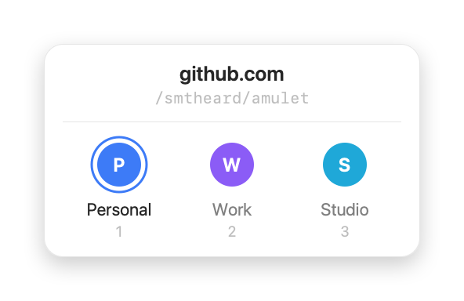

# Amulet

Pick a Chrome profile for every link you open.



Amulet is a tiny macOS app that you set as your default browser. When any app opens a
link, a picker appears at your pointer. Choose a profile and the link opens in Chrome
in that profile. A small item with a big effect.

It is one Swift file with no dependencies. It makes no network requests and needs no
permissions.

## Install

You need Google Chrome and the Xcode Command Line Tools (`xcode-select --install`).
Amulet needs macOS 14 or later and has been tested on macOS 27.

```sh
git clone https://github.com/smtheard/amulet.git
cd amulet
cp Profiles.example.swift Profiles.swift
```

Edit `Profiles.swift` so it has one line per Chrome profile:

```swift
Profile(dir: "Default", name: "Personal", color: 0x3D7BF7),
```

- `dir` is the profile's folder name. In Chrome, open `chrome://profile-internals`,
  expand the profile and take the last part of its **Profile Path**, such as `Default`
  or `Profile 1`.
- `name` and `color` are what the picker shows.

List only folders that exist: Chrome creates an empty profile for a folder it doesn't
know. The folder names have to come from you. Recent versions of macOS don't let
other apps, or an agent setting this up, read Chrome's profile list.

Then build, install into `~/Applications`, and make Amulet the default browser:

```sh
./build.sh
~/Applications/Amulet.app/Contents/MacOS/Amulet --make-default
```

macOS may ask you to confirm the change. To check it works, run
`open https://example.com`; the picker should appear.

After you edit `Profiles.swift`, run `./build.sh` again. The file is ignored by git.

## Use

| Key | Action |
| --- | --- |
| `1`–`9` | Open in that profile |
| `←` `→` or `Tab`, then `Return` | Choose with the keyboard |
| Click | Open in that profile |
| `Esc` | Drop the link |

Links you click inside Chrome stay in Chrome.

## Uninstall

Choose another default browser in System Settings, then delete
`~/Applications/Amulet.app`.

## How it works

`Info.plist` registers Amulet as a handler for `http` and `https` links. When a link
arrives, Amulet shows the picker and then runs:

```sh
open -n -b com.google.Chrome --args --profile-directory=<dir> <url>
```

## License

[MIT](LICENSE)
